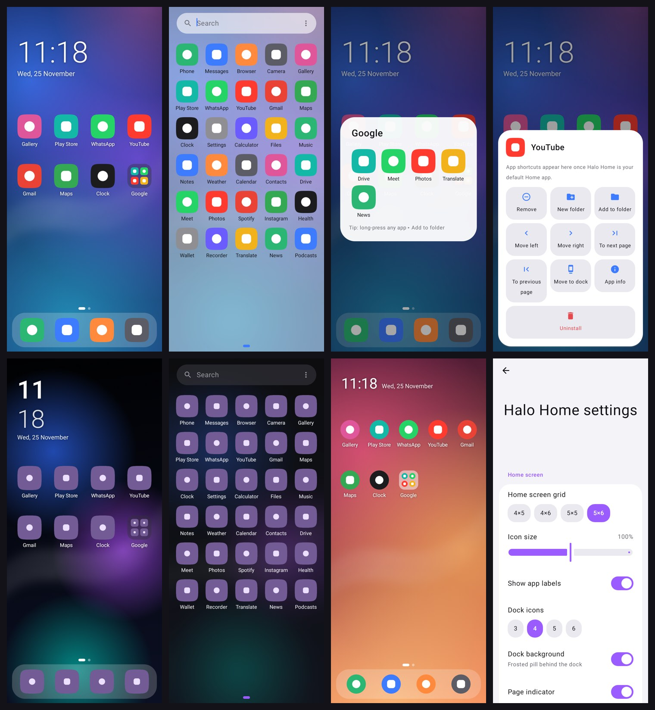

# Halo Home — a One UI 8-inspired launcher for Android

A light, fast home-screen launcher built for low-end phones like the Galaxy A05 (Android 8.0+, tuned for Android 14/15).
The design recreates the *feel* of a modern Galaxy home screen — rounded squircle icons, big rounded cards, airy spacing,
spring animations and frosted glass — using **only original code and artwork**. It is not affiliated with Samsung and
contains no Samsung icons, wallpapers, fonts or APK code.



> Screenshots are rendered off-device (Robolectric, 360×800 dp) with placeholder app icons. On a phone you see your real app icons.

## Features
- **Real Home app**: registers as `HOME`/`DEFAULT`; first-run welcome screen with “Set as default” (role request → Default apps settings fallback).
- **Home screen**: grid 4×5 / 4×6 / 5×5 / 5×6, icon size slider, labels on/off, pages + page indicator, dock (3–6 icons, optional frosted pill).
- **Clock header widget** (built-in clock, no API keys): Big / Stacked / Compact / Hidden, date + battery; tap clock → alarms, tap date → calendar.
- **Apps screen**: swipe up; One UI-style horizontal pages *or* vertical list; 4–6 columns; search bar (Enter launches the top hit or searches the web); work-profile apps.
- **Folders**: 2×2 preview tile, rounded popup with spring scale-in, tap title to rename, add/remove/ungroup.
- **Long-press an app**: app shortcuts (when default), App info, Uninstall, Add to Home, Add to folder, New folder, move left/right, move page, move to/from dock, hide.
- **Long-press empty space**: Wallpapers, Widgets, Settings, add/remove pages, quick dark-mode toggle.
- **Widgets** via `AppWidgetHost`: picker of every installed widget, bind/configure flow, full-width widget rows, make taller/shorter or remove.
- **Icons**: squircle / circle / rounded square; Original, Themed (accent-tinted, uses Android 13+ monochrome layers) or Monochrome; **ADW/Nova-style icon packs** (`appfilter.xml`).
- **Look**: Auto / Light / Dark, 11 accent swatches + custom hue, background blur (with strength), animation speed, haptics.
- **8 original wallpapers** generated on the device (Aurora Glass, Lavender Bloom, Mint Flow, Sunset Silk, Graphite, Coral Dune, Midnight Orbs, Ice Light), or use your phone’s wallpaper; can also set one on the lock screen.
- **Gestures**: swipe up → Apps; swipe down → notification panel / search / nothing; double-tap → lock / Apps / nothing.
- **Hide apps**, **backup & restore** (layout + settings to a JSON file you choose), reset Home screen.

## Install
1. Download `HaloHome-v1.0.0.apk` from the Releases page on the phone.
2. Open it → allow **Install unknown apps** for your browser/Files app when asked → Install.
3. Open Halo Home → **Set as default**, or go to **Settings ▸ Apps ▸ Default apps ▸ Home app ▸ Halo Home**.
4. Optional: double-tap to lock needs **Settings ▸ Accessibility ▸ Installed apps ▸ Halo Home gestures ▸ On**.
   The service only performs “lock screen” / “open notifications” actions and reads no screen content.

To go back to One UI Home: Settings ▸ Apps ▸ Default apps ▸ Home app ▸ One UI Home.

## Known limits
- **Swipe down for notifications** uses the accessibility service if it’s on; otherwise a system call that most phones (including Samsung) allow, but some builds may block it.
- **Double-tap to lock** needs the optional accessibility service (Android 9+).
- **Blur**: smooth frosted blur is always available with the built-in wallpapers. With your own phone wallpaper it uses Android 12+ window blur only if the phone supports it (many budget phones turn this off), otherwise a tinted glass panel.
- App shortcuts only appear while Halo Home is the default Home app (Android rule). Apps asking to “pin” shortcuts to Home and notification dots aren’t supported yet.
- Widgets are placed as full-width rows at the top of a page (no free drag-and-drop yet); items are arranged with the long-press menu.
- Restoring a backup restores apps, folders, dock and settings; widgets have to be re-added.

## Build
```
JAVA_HOME=<jdk17> ./gradlew assembleRelease      # app/build/outputs/apk/release/app-release.apk
./gradlew testDebugUnitTest                       # layout unit tests + Robolectric screenshot previews -> docs/screenshots
```
Kotlin 2.0 · Jetpack Compose (BOM 2024.10) · minSdk 26 · targetSdk 35 · R8-shrunk (~1.2 MB).
